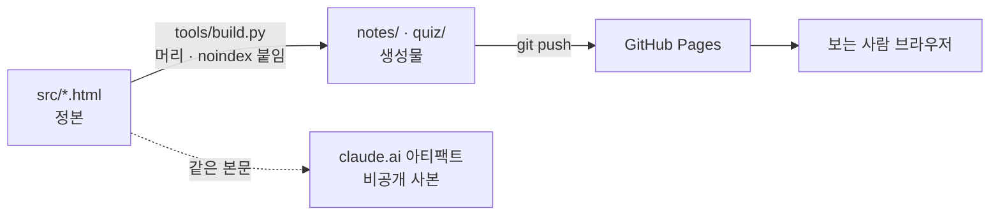

# 아키텍처

서버 없는 정적 사이트다. 페이지마다 HTML 파일 하나에 CSS와 JS가 모두 들어 있다.

| 구성요소 | 역할 |
|---|---|
| `src/notes.html` | 챗봇 설계 공부노트 본문. 해시(`#map` 등)로 장을 바꾼다 |
| `src/quiz.html` | 복습 퀴즈 본문. 문항 데이터가 파일 안에 있다 |
| `tools/build.py` | 본문에 문서 머리를 붙여 Pages용 파일을 만든다 |
| GitHub Pages | `main` 브랜치 루트를 그대로 정적 호스팅 |
| 브라우저 `localStorage` | 푼 기록 · 적은 답을 그 브라우저에만 저장 |

claude.ai에서 열면 `window.claude`의 `sample` 기능으로 채점 · 묻기가 동작한다. GitHub Pages에서는 그 기능이 없어 안내 문구만 보인다.
