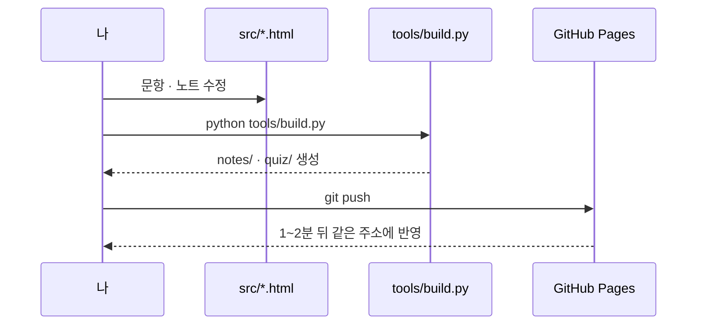

# 흐름 설계

## 1. 내용 고치기에서 공개까지

## 2. 퀴즈 한 문항 풀기

1. 객관식 · OX: 보기를 누르면 바로 정답 · 오답을 표시하고 해설을 연다. 결과는 `localStorage`에 저장한다.
2. 서술형: 내 답을 적고 "모범 답 보기"로 비교한다. claude.ai에서 열었을 때만 "Claude에게 채점받기"가 동작한다.
3. "틀린 것만"을 켜면 틀린 객관식 · OX만 다시 보인다.
